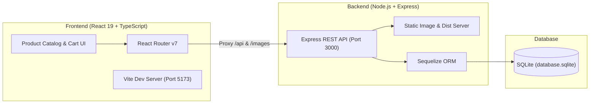

# 🛒 Full-Stack E-Commerce Platform

A production-ready, full-stack Amazon-inspired e-commerce web application engineered with **React 19**, **TypeScript**, **Vite**, **Express.js**, and **SQLite (Sequelize ORM)**.

[](https://react.dev/)
[](https://www.typescriptlang.org/)
[](https://vitejs.dev/)
[](https://nodejs.org/)
[](https://expressjs.com/)
[](https://sequelize.org/)
[](https://vitest.dev/)
[](LICENSE)

---

## 🌟 Live Demo

> 🔗 **Live Application URL:** *[Deploy on Render / Railway to add your live URL here]*  
> *(e.g., `https://ecommerce-fullstack-demo.onrender.com`)*

---

## ✨ Key Features

- 🛍️ **Interactive Product Catalog:** Responsive product grid with rating stars, price calculations, and dynamic search filtering.
- 🛒 **Full-Featured Cart Management:** Add items to cart, modify quantities in real-time, or remove products with instant subtotal recalculations.
- 🚚 **Delivery Date & Shipping Options:** Choose between Standard, Expedited, and Express shipping with live estimated arrival dates.
- 💳 **Checkout & Payment Summary:** Instant computation of product subtotal, shipping costs, estimated 10% tax, and final order total.
- 📦 **Order History & Delivery Tracking:** Review past order receipts, inspect ordered items, and track shipping stages on an interactive timeline.
- 🧪 **Comprehensive Automated Testing:** Vitest & React Testing Library test suites covering utilities, component rendering, and user cart interactions.
- 🔄 **Automated Seed Data & API Reset:** Built-in seed data loader with a dedicated `/api/reset` route to restore the database to a clean initial state anytime.

---

## 🏗️ Architecture



---

## 🛠️ Tech Stack

### Frontend
- **Framework:** React 19 + TypeScript
- **Bundler & Build Tool:** Vite
- **Routing:** React Router v7
- **HTTP Client:** Axios
- **Testing:** Vitest, React Testing Library, `@testing-library/user-event`, jsdom
- **Date Utility:** Day.js

### Backend
- **Runtime:** Node.js (v18+)
- **Framework:** Express.js
- **ORM & Database:** Sequelize ORM with SQLite
- **Middleware:** CORS, Express JSON parser, static file serving

---

## 📁 Repository Structure

```
ecommerce-fullstack/
├── frontend/                     # React 19 + TypeScript client
│   ├── src/
│   │   ├── assets/               # Icons, logos, and UI assets
│   │   ├── components/           # Reusable UI (Header, Search, etc.)
│   │   ├── pages/
│   │   │   ├── home/             # Product catalog, grid & tests
│   │   │   ├── checkout/         # Cart, delivery options, payment summary
│   │   │   ├── orders/           # Order history & details
│   │   │   └── Tracking.jsx      # Delivery tracking timeline
│   │   ├── utils/                # Money formatting & unit tests
│   │   ├── App.tsx               # Main routing orchestrator
│   │   └── main.tsx
│   ├── package.json
│   ├── tsconfig.json
│   ├── vite.config.ts            # Proxy config & build target
│   └── vitest.config.js
│
├── backend/                      # Express + SQLite API server
│   ├── defaultData/              # Seed products, delivery options, orders
│   ├── images/                   # Product & rating image assets
│   ├── models/                   # Sequelize data models (Product, CartItem, Order, DeliveryOption)
│   ├── routes/                   # Modular API route controllers
│   │   ├── products.js           # GET /api/products (?search=...)
│   │   ├── cartItems.js          # GET, POST, PUT, DELETE /api/cart-items
│   │   ├── deliveryOptions.js    # GET /api/delivery-options
│   │   ├── orders.js             # GET, POST /api/orders
│   │   ├── paymentSummary.js     # GET /api/payment-summary
│   │   └── reset.js              # POST /api/reset
│   ├── package.json
│   └── server.js                 # Entry point & static dist server
│
├── .gitignore                    # Ignores node_modules, database.sqlite, dist, .env
├── package.json                  # Root runner scripts
└── README.md                     # Comprehensive documentation
```

---

## 📡 REST API Reference

| Method | Endpoint | Description |
| :--- | :--- | :--- |
| `GET` | `/api/products` | Retrieve all products (supports `?search=query`) |
| `GET` | `/api/delivery-options` | Fetch available delivery speeds and pricing |
| `GET` | `/api/cart-items` | Get current items in shopping cart |
| `POST` | `/api/cart-items` | Add new item or increment quantity `{ productId, quantity }` |
| `PUT` | `/api/cart-items/:id` | Update cart item delivery option or quantity |
| `DELETE` | `/api/cart-items/:id` | Remove item from cart |
| `GET` | `/api/payment-summary` | Calculate subtotal, shipping fees, tax, and total |
| `GET` | `/api/orders` | Retrieve list of placed orders |
| `GET` | `/api/orders/:id` | Fetch specific order details (supports `?expand=products`) |
| `POST` | `/api/orders` | Place a new order from current cart items |
| `POST` | `/api/reset` | Reset database and restore default seed catalog |

---

## 🚀 Quick Start Guide

### Prerequisites
- [Node.js](https://nodejs.org/) (version 18 or higher recommended)
- `npm`

### 1. Clone the repository
```bash
git clone https://github.com/agra-ankit/ecommerce-fullstack.git
cd ecommerce-fullstack
```

### 2. Install Dependencies
You can install dependencies for both frontend and backend using the root helper script:
```bash
npm run install:all
```
*(Or install manually: `cd backend && npm install`, then `cd ../frontend && npm install`)*

### 3. Run in Development Mode
Run both backend and frontend servers:

- **Terminal 1 (Backend API):**
  ```bash
  cd backend
  npm run dev
  ```
  *Server starts on `http://localhost:3000` and automatically populates the SQLite database.*

- **Terminal 2 (Frontend Client):**
  ```bash
  cd frontend
  npm run dev
  ```
  *Vite client starts on `http://localhost:5173` with hot-module replacement and API proxying.*

### 4. Run Automated Tests
```bash
npm test
```
*(Or inside `frontend/`: `npx vitest run`)*

### 5. Production Build & Run
To compile TypeScript and bundle the frontend into the Express server:
```bash
npm run build
npm start
```
Open `http://localhost:3000` to view the full application served directly by Express.

---

## 🌐 Deploy to Render (Free Web Service)

Since the Express backend is pre-configured to serve both the REST API and the compiled React `dist/` directory, you can deploy the complete full-stack app as a single service on **Render**:

1. Push this repository to GitHub.
2. Sign in to [Render](https://render.com) and click **"New +"** > **"Web Service"**.
3. Select your `ecommerce-fullstack` repository.
4. Set the following configuration:
   - **Environment:** `Node`
   - **Build Command:** `npm install --prefix backend && npm install --prefix frontend && npm run build --prefix frontend`
   - **Start Command:** `node backend/server.js`
5. Click **"Create Web Service"**.
   Render will build the frontend, seed the SQLite database, and launch the application on a live HTTPS URL.

---

## 📝 License

This project is licensed under the MIT License.
